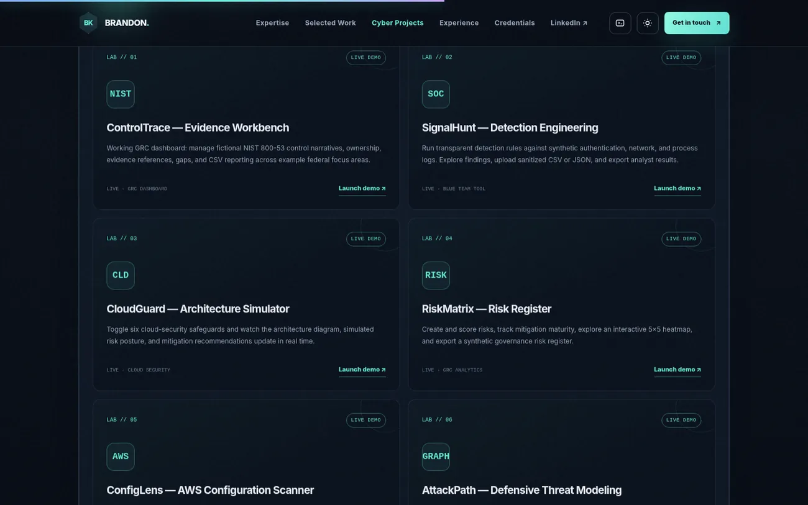

# Brandon Keesecker — Cybersecurity Portfolio


**Seven local-first interactive cybersecurity labs** · 49 automated tests · Synthetic data · No API keys or cloud credentials required.

An animated, responsive, self-contained professional cybersecurity website. It does not require an API key, build system, package installation, account, or paid service.



## Source and professional profiles

- GitHub: https://github.com/itsbdk03
- LinkedIn: https://www.linkedin.com/in/brandon-keesecker-i-ccsk-aws-ccp-24463b242/
- Public repository: https://github.com/itsbdk03/Brandon-Keesecker-Cyber

## Open the website

Open `index.html` in any modern browser. To put it on the public internet, upload the file to a static host such as GitHub Pages, Cloudflare Pages, Netlify, or another static hosting service.

## What's included

- Animated cyber hero with network particles, security graphics, responsive orbit effects, and scrolling animations.
- Professional overview covering FedRAMP Low/Moderate/High, DoD IL4/IL5/IL6, security documentation development, CMMC, and cloud security.
- Interactive HITRUST, HIPAA, SOC 2, and cross-framework GRC explorer. Wording intentionally distinguishes additional GRC experience from deeper federal advisory work.
- Filterable **Selected Work** cards about professional methods, described without client names or sensitive engagement details.
- Dedicated **Cyber Projects** tab with SEVEN working, interactive projects: ControlTrace, SignalHunt, CloudGuard, RiskMatrix, ConfigLens, AttackPath, and AssuranceFlow.
- Dedicated **LinkedIn** tab and large social section, now connected directly to Brandon’s LinkedIn profile.
- Experience and education timeline, including your WVU master's degree and a **planned** (not earned) doctorate in cybersecurity.
- Certifications including CCSK, CompTIA A+, Google and Microsoft certifications.
- Interactive terminal (type `help`, `skills`, `grc`, `doctorate`, `projects`, etc.).
- Command palette with Ctrl+K / Cmd+K, dark/light mode, mobile navigation, accessible focus states, reduced-motion support.

## LinkedIn profile — already connected

The navigation tab, LinkedIn contact button, and terminal now point to Brandon’s public profile:

https://www.linkedin.com/in/brandon-keesecker-i-ccsk-aws-ccp-24463b242/

No further LinkedIn setup is needed. If you ever change your LinkedIn profile address, edit the `linkedinUrl` field in the `SITE_CONFIG` block inside `index.html`.

## Interactive cybersecurity engineering labs

The `labs/` folder now contains **six integrated workbenches plus a standalone AssuranceFlow documentation studio**, with full source code and documentation. Every project has its own live, direct-linkable URL path within the site:

| Project | URL after publishing | What visitors can do |
|---|---|---|
| ControlTrace | `yourdomain/labs/index.html#controls` | Edit sample NIST controls, map evidence, track gaps, export CSV |
| SignalHunt | `yourdomain/labs/index.html#hunt` | Run detection heuristics, import a sample CSV or JSON, export findings |
| CloudGuard | `yourdomain/labs/index.html#cloud` | Toggle cloud defenses and see simulated risk posture and architecture change |
| RiskMatrix | `yourdomain/labs/index.html#risk` | Add risks, adjust mitigation maturity, filter a 5×5 heat map, export CSV |
| ConfigLens | `yourdomain/labs/index.html#config` | Inspect fictional AWS JSON, compare configurations, remediate findings, export SARIF |
| AttackPath | `yourdomain/labs/index.html#path` | Test simulated attack routes, compare safeguards and download analysis |
| AssuranceFlow | `yourdomain/labs/assuranceflow.html` | Inspect security narratives and evidence quality, triage documentation gaps, export reviewer workpapers |

- `labs/index.html` — six integrated workbenches, with responsive interactive UI
- `labs/assuranceflow.html` — seventh standalone, browser-based control documentation workbench
- `labs/labs.css` — lab styling and mobile layouts
- `labs/labs.js` — documented code for the four original modules
- `labs/enhancements.js` and `labs/enhancements.css` — additional analytics, investigations and downloadable briefs
- `labs/configlens.js` — twelve explainable AWS JSON security checks, severity filtering, report and SARIF exports
- `labs/methodology.html` — browser-readable case studies covering technical design and known limitations
- `labs/samples/configlens-exposed.json` and `configlens-hardened.json` — documented fictional test inputs
- `labs/samples/events-demo.csv` — synthetic sample log file to download and load into SignalHunt
- `labs/README.md` — each project's data model, detection rules, assessment caveats, and references

**Important when publishing:** upload the **entire website folder**, including the `labs` subfolder. Do **not** upload only `index.html`, or the project links will be broken.

The `SITE_CONFIG.projects` array inside your portfolio homepage already points to each project using safe relative URLs. The existing LinkedIn tab still links to your real profile.

For further GitHub project links, add cards to `SITE_CONFIG.projects` with `title`, `category`, `icon`, `summary`, `url`, and `type` fields. Do not publish confidential client information, CUI, production artifacts, or credentials.

## Interview-ready guided walkthroughs

See **[Project demonstration guide](docs/DEMO-GUIDE.md)** for practical, 1–3 minute reviewer exercises for each lab. Each walkthrough identifies what to click, what output to expect, what the result does **not** prove, and which engineering choices the reviewer can verify in the source code.

### Recent improvements to the existing labs

- **ConfigLens:** an evidence-first scope review surfaces unassessed fields and omitted configuration categories separately from passed rules. Capture a baseline and compare modified snapshots; missing evidence is **not** labeled remediated. Export a standalone remediation brief.
- **SignalHunt:** the correlation engine now requires a single identity and source IP for the failure-to-success authentication chain, reducing cross-source false positives. Later process/network activity is clearly labeled contextual, not causal.
- **Verification:** new regression tests cover uncertain data, remediation comparisons, invalid ports, temporal windows and cross-IP log sequences. CI also checks embedded JavaScript syntax, project routes and source files.

## Recommended before publishing

- Your public LinkedIn URL is already configured and can be tested after deployment.
- Review the email address currently in the contact section and update it if necessary. It also appears in the copy-email handler and terminal.
- Review the listed credentials and educational degree wording, especially the planned doctorate. This site intentionally does **not** claim you hold a doctorate.
- Test all seven included live project links on your deployed domain. You can add GitHub repositories later if you wish.
- Optionally add a downloadable résumé or headshot with your own approved images.
- Review any professional information for permission to share before publication.

## Technical notes

The main portfolio is implemented using HTML, CSS, and vanilla JavaScript inside `index.html`; the seven interactive labs use static files in `labs/`. Text content is inserted safely (without accepting raw markup from project descriptions); project URLs are accepted only when they are valid HTTP or HTTPS URLs. All existing animations and interactions are local to the browser. No visitors' data is collected or sent to a server by the site itself.


## Version 7: AttackPath defensive threat modeling

- Sixth runnable lab: `labs/index.html#path`. A no-backend attack graph with three scenarios, seven defensive safeguards, live reachability traces, prioritized fixes, Markdown analysis reports and JSON exports.
- `labs/attackpath-engine.js` is a dependency-free graph engine that runs in browsers and Node.js.
- Run verification from the extracted folder: `node --test labs/tests/attackpath.test.cjs`. Automated test cases use fictional configurations.
- GitHub Actions example: `.github/workflows/verify.yml`. Copy the entire folder to a repository to enable it.
- For recruiter credibility, link to actual public source repositories and report test results accurately. Avoid presenting these sample exercises as live client engagements.

## GitHub-ready edition (v8)

- **ConfigLens security rules are now independently testable** through `labs/configlens-engine.js`. Its browser UI uses the same engine as the Node.js tests, rather than a duplicate implementation.
- Portable Node.js regression tests now cover both ConfigLens and AttackPath.
- `.github/workflows/verify.yml` checks source syntax, website references and unit tests for push and pull requests.
- Professional architecture, publishing and responsible-use documents are in [`docs/ARCHITECTURE.md`](docs/ARCHITECTURE.md), [`docs/PUBLISHING.md`](docs/PUBLISHING.md), and [`SECURITY.md`](SECURITY.md).

**Run locally (Node.js 20+):**

```bash
npm run check:js
npm run verify
```

**Publishing and hosting:** Source code is maintained in this repository. See [docs/PUBLISHING.md](docs/PUBLISHING.md) for optional GitHub Pages hosting. Neither client records nor credentials should be published.

## Public sharing note

The examples are synthetic and educational, not live client work or production certification tooling. Review all professional and contact information before public sharing. Screenshots are optimized for repository viewing.

## AssuranceFlow — documentation engineering studio (lab 07)

Visit [`labs/assuranceflow.html`](labs/assuranceflow.html) for a local-first demo of control documentation quality reviews. It supports synthetic NIST-style control implementation narratives, evidence traceability, prioritized gap lists, a narrowly scoped OSCAL SSP implementation-description importer, local JSON workpapers, and a partial OSCAL-oriented implementation export. It **does not** validate an OSCAL schema, baseline coverage, compliance, or authorization. The engine is in `labs/assuranceflow-engine.js` and is covered by 12 portable Node.js tests. Official reference: https://pages.nist.gov/OSCAL-Reference/models/v1.2.3/system-security-plan/json-reference/ .

## Guided reviewer mode (all seven existing labs)

A non-blocking, keyboard-accessible **Guided walkthrough** control is available inside both the six-tab lab hub and AssuranceFlow. Four curated steps per lab highlight the specific controls to inspect, the outcome to validate, and the scenario limitations. The tour supports Previous, Next, Finish, Escape to close, focus indicators, responsive layouts, and reduced-motion preferences. No browser data or client evidence is transmitted.

The separate script and stylesheet are `labs/reviewer-tour.js` and `labs/reviewer-tour.css`. The site verifier checks their integration.
