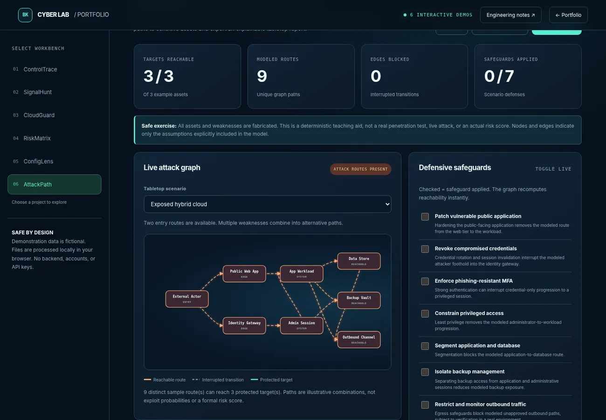
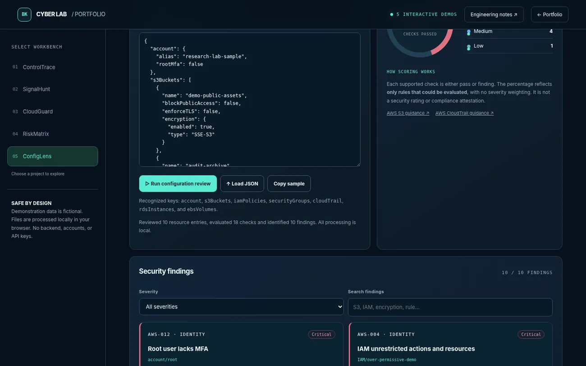
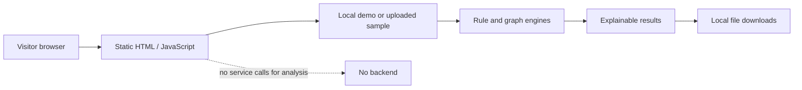

# Security engineering portfolio — architecture

## Repository topology

```text
index.html                  Public portfolio and links to all six demos
labs/index.html             Shared browser UI for the demos
labs/labs.js                ControlTrace, SignalHunt, CloudGuard, RiskMatrix client logic
labs/configlens-engine.js   Portable, testable JSON configuration rule engine
labs/configlens.js          ConfigLens presentation and SARIF/report export
labs/attackpath-engine.js   Pure graph analysis and prioritization engine
labs/attackpath.js          AttackPath browser controller and report export
labs/samples/               Synthetic inputs for repeatable demonstrations
labs/tests/                 Dependency-free Node.js regression tests
.github/workflows/verify.yml CI verification on pushes and PRs
tools/                      Static website and JavaScript checks
```

## Screenshots





## Trust boundaries and data flow



- The apps operate entirely in the browser. There is no cloud API permission, user account, database, or telemetry collector.
- Imported JSON and CSV are parsed locally. Do not upload customer data, controlled unclassified information, PHI, credentials or keys to a public portfolio demonstration.
- ControlTrace and RiskMatrix may persist their **example** inputs in local browser storage.
- ConfigLens operates on its **own small JSON summary format**, not a real AWS IAM policy AST or Terraform HCL. Omitted fields are unknown, not secure.
- AttackPath is a deterministic reachability model. It does not exploit systems or evaluate real vulnerabilities.
- Reports and severity choices are educational, not authoritative FedRAMP/DoD, HIPAA, or SOC 2 conclusions.

## Validation

Run `npm run check:js` and `npm run verify` using Node.js 20+. CI runs the same tests. The Node tests cover rule selection and modeled graph behavior but do not guarantee product security or current regulatory accuracy. Review official source material before applying rules in production.

## Deployment

The root `index.html` is a static entry point. GitHub Pages can publish it from the `main` branch root (Settings → Pages → Deploy from a branch → main / root). The empty `.nojekyll` file avoids an unnecessary Jekyll processing stage. Netlify may also host the same folder.
