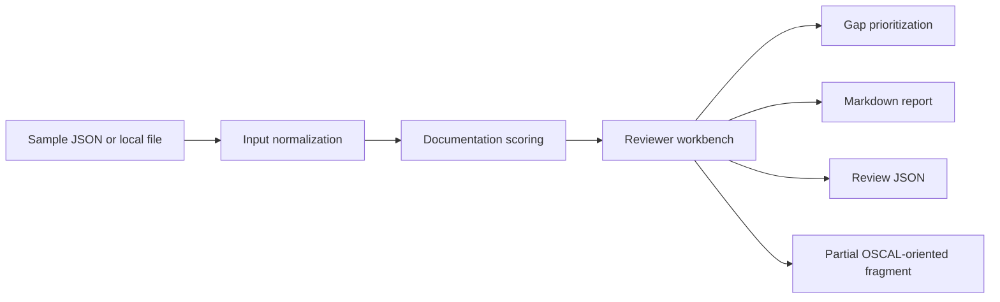

# AssuranceFlow — security documentation automation case study

**Owner:** Brandon Keesecker • **Type:** Independent educational security engineering exercise • **Data:** Fictional

## Problem and motivation

Security control documentation is often split between ownership spreadsheets, implementation statements, evidence indexes, and remediation notes. Reviewers need an explainable way to identify incomplete records before formal assessment. AssuranceFlow is a proof of concept for that *documentation hygiene* problem, not an authorization or audit platform.

## Architecture

The zero-dependency rule engine is `labs/assuranceflow-engine.js`. The user-facing page is `labs/assuranceflow.html`, with native DOM rendering and no backend. Imported files are handled by the user's browser. The implementation has 12 deterministic Node.js regression tests in `labs/tests/assuranceflow.test.cjs`.

## Data model

Each illustrative record has `id`, `title`, `owner`, `status`, `narrative`, `evidence` (array of fictional identifiers), and `gap`. A local JSON import accepts `{ "controls": [...] }` (max 250 controls, 1 MB at the file input).

A limited import also reads descriptions and control IDs from `system-security-plan.control-implementation.implemented-requirements`. Because the imported SSP fragment does not reliably convey evidence ownership, completeness, or authorization status, those fields are left **unverified**. This is not a round-trip serializer or a schema validator.

## Demonstration scoring

The score is an explicit heuristic: owner present (15), narrative length at least 45 characters (30), one evidence ID (30), status implemented (25) or in review (10). A free-text open gap and non-implemented status produce reviewer notes. The score is *not* a control effectiveness rating or compliance outcome. The workbench prioritizes records with low documentation scores.

## Design and trust boundaries

- Data is processed in the browser with no uploaded telemetry.
- DOM text nodes are used for imported record values; no untrusted HTML is rendered.
- Control IDs, input size, record count, field length, and evidence count are bounded.
- Browser-local exports are for review only. The `control-implementation` fragment omits all other SSP elements required for a full OSCAL system security plan.
- The sample records are not derived from a client assessment and do not represent a complete FedRAMP or DoD baseline.

## Validation

Run `npm run check:js`, `npm run verify`, or `npm test`. Tests cover duplicate prevention, malformed IDs, capacity bounds, deterministic scoring, import formats, non-mutation, reporting disclaimers, and partial fragment shape. These are software behavior checks, **not** OSCAL-schema conformance tests.

## Potential roadmap

For a production-grade project, add official OSCAL metaschema/schema validation, baseline-specific authoritative catalog imports, UUID relationships, component assembly, versioned evidence references, control parameter inheritance, reviewer approvals, and a secured persistence layer. Those are **not implemented** in this demo.

## Primary source

NIST's official [OSCAL SSP JSON reference](https://pages.nist.gov/OSCAL-Reference/models/v1.2.3/system-security-plan/json-reference/) and [NIST's public OSCAL examples](https://github.com/usnistgov/oscal-content).
